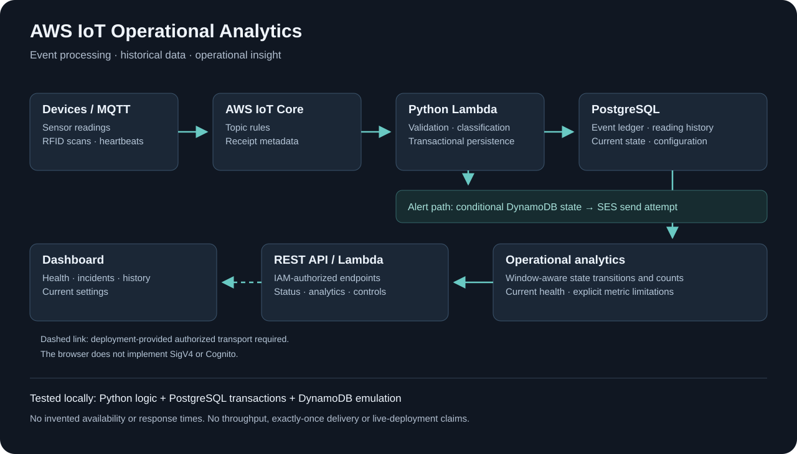
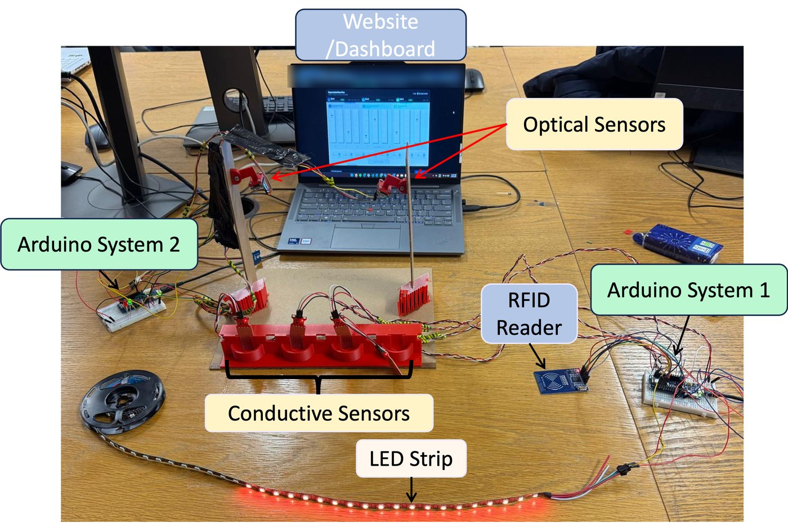
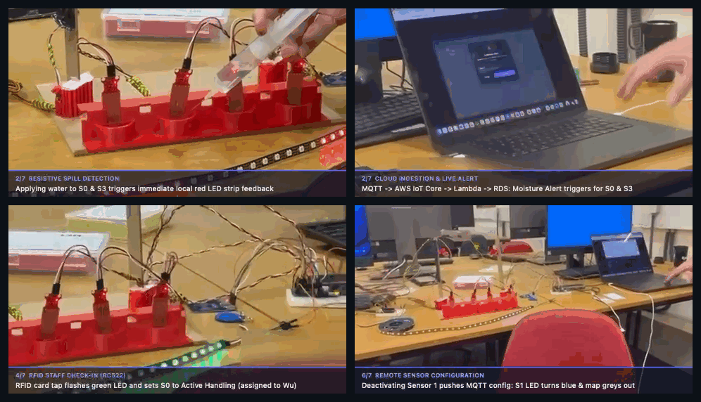
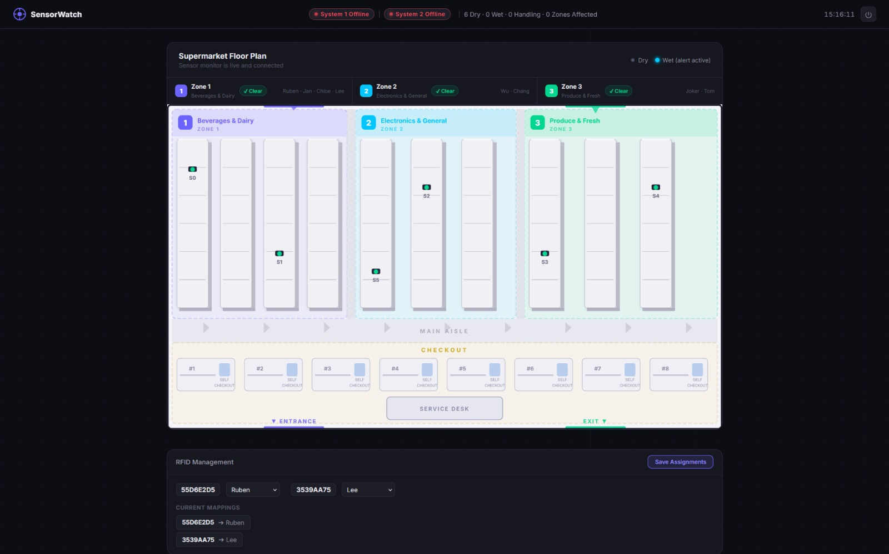
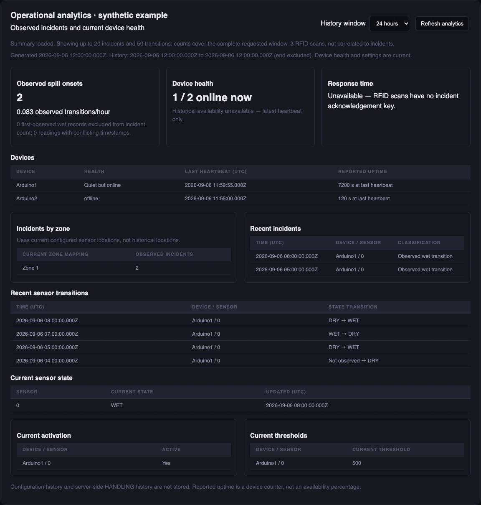
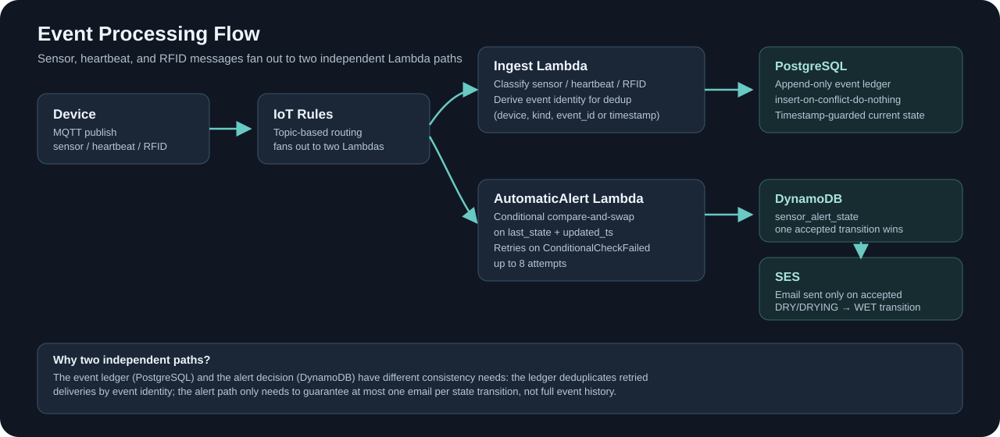
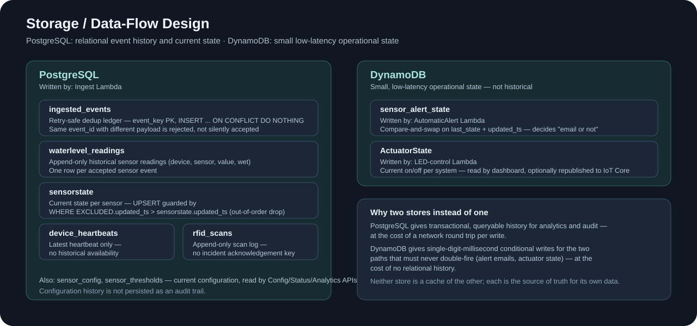
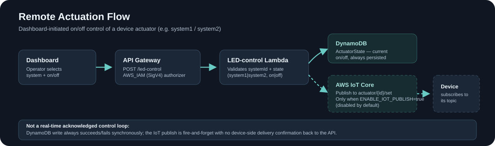

# Edge-to-Cloud IoT Event Platform — Smart Spill Detection

[](https://github.com/fengzhe-li/edge-to-cloud-iot-event-platform/actions/workflows/backend.yml)

An event-driven edge-to-cloud backend: MQTT devices publish through AWS IoT
Core, IoT Rules fan out to Python Lambda functions that deduplicate and
persist events, and an IAM-authorized API surfaces current state, incident
history and operational analytics to a lightweight JavaScript dashboard. The
concrete domain example is IoT spill-sensor detection, built around AWS IoT
Core, Lambda, API Gateway, PostgreSQL, DynamoDB and SES.

**Project origin.** The [original spill-detection system](https://github.com/fengzhe-li/aws-iot-smart-spill-detection-system)
was a six-member collaborative university group project (**UCL ELEC0130 Internet of Things, 2026**) and is preserved separately. This
repository is **Fengzhe Li's independent software engineering upgrade** of that platform: it adds tested data-integrity
behaviour, retry-safe ingestion, conditional alert deduplication, and read-only operational analytics without introducing a new
streaming platform.



## Physical Prototype & Project Origins

Before this backend reliability and analytics upgrade, the platform originated as a physical edge-to-cloud IoT prototype developed collaboratively by a six-member team (**Jan Frederik Kollmorgen, Ruben Conteiro, Shen Wu, Geyu Huang, Fengzhe Li, and Yikun Chang**) for the **UCL ELEC0130 Internet of Things (2026)** module.

- **[▶ Watch the Original Hardware & Cloud Demonstration Video (3m 14s)](https://github.com/fengzhe-li/aws-iot-smart-spill-detection-system/blob/main/docs/media/iot-spill-detection-demo.mp4)** *(hosted in the original group repository)*
- **[Original Group Project Repository (`aws-iot-smart-spill-detection-system`) →](https://github.com/fengzhe-li/aws-iot-smart-spill-detection-system)**

### Original Arduino Edge Hardware & AWS Connectivity

The physical prototype used two **Arduino MKR WiFi 1010** microcontrollers (`u-blox NINA-W102` Wi-Fi + `ATECC508A` hardware crypto element for X.509 mutual-TLS authentication to AWS IoT Core) to compare two complementary liquid-sensing modalities on a physical floor-plan test rig:

1. **System 1 (`Arduino1` — Conductive Sensing & RFID Ack):** Monitored four **DollaTek conductive water-level sensors (`S0`–`S3`)** over 12-bit ADC inputs (`1 Hz` sampling, 10-sample circular buffer, 3-state `DRY`/`WET`/`DRYING` edge state machine), paired with an **MFRC522 (`13.56 MHz`) SPI RFID reader** for on-site staff attendance scans and a **20-pixel `WS2812B` RGB LED strip** for local visual/remote actuator feedback.
2. **System 2 (`Arduino2` — Non-Contact Optical IR Sensing):** Monitored two **Vishay `VCNL4200` (`940 nm`) I²C optical infrared proximity sensors (`S4`–`S5`)** (`10 Hz` sampling, automatic startup dry-baseline calibration, 20-sample moving average, hysteresis and consecutive hit-count validation) with local green/red status LEDs.

Instead of streaming over **2.07 million raw ADC/I²C samples per day** to the cloud, the edge firmware published only confirmed state transitions (`waterlevel/sensors/{id}/state`), RFID tag scans (`sensors/rfid`), and 10-second heartbeats (`waterlevel/heartbeat`) over MQTT/TLS to **AWS IoT Core**, reducing downstream persistence traffic to ~**3.6 MB/day per device**.

| Original Dual-Arduino Hardware Test Rig (`Arduino1` & `Arduino2`) | Live Demonstration Keyframes (Spill, Alert, RFID & Remote Actuator) |
| :---: | :---: |
|  |  |
| *Historical material from the six-member UCL ELEC0130 group project: physical floor-plan rig with `Arduino1` (conductive `S0`–`S3`, `RC522` RFID, `WS2812B` LED strip) and `Arduino2` (`VCNL4200` optical IR `S4`–`S5`).* | *Historical material from the six-member UCL ELEC0130 group project: keyframes from the physical lab evaluation showing water spill detection, `SensorWatch` UI updates, SES alert delivery, and RFID scan.* |


*Historical material from the six-member UCL ELEC0130 group project: original `SensorWatch` web dashboard showing live `Arduino1`/`Arduino2` connection telemetry, interactive 6-sensor floor-plan map (`S0`–`S5`), and recent RFID attendance scans.*

### Scope Distinction: Collaborative Origins vs. Independent Upgrade

- **Original Group Project ([`aws-iot-smart-spill-detection-system`](https://github.com/fengzhe-li/aws-iot-smart-spill-detection-system)):** Collaborative six-member coursework covering the physical Arduino circuits, conductive and optical edge firmware, original AWS IoT/Lambda/RDS/DynamoDB/SES cloud wiring, and the original `SensorWatch` dashboard shown above.
- **This Repository ([`edge-to-cloud-iot-event-platform`](https://github.com/fengzhe-li/edge-to-cloud-iot-event-platform)):** Independent post-coursework software engineering upgrade by **Fengzhe Li**, re-architecting the backend ingestion, deduplication ledger, compare-and-swap alert concurrency guards, read-only `/analytics/summary` subsystem, SAM infrastructure-as-code (`AWS_IAM`), and automated 102-test verification suite.

## What the project demonstrates

- **Event processing:** classify and normalise sensor, RFID and heartbeat messages.
- **Data integrity:** transactional retry deduplication and timestamp-guarded updates
  keep historical records separate from current sensor state.
- **Operational analytics:** device health, last-seen time, reported uptime, observed
  wet transitions by sensor/device/current zone, and configurable history windows.
- **Backend interfaces:** status, configuration, threshold, actuator, email and
  analytics handlers, with a SAM template for the supported seven-function backend.
- **Engineering verification:** 102 tests passed locally, including 15 real PostgreSQL
  integration tests and four DynamoDB-emulator integration tests. GitHub Actions
  runs the suite with PostgreSQL plus lint, syntax and configuration checks.

## Analytics dashboard

The image below uses **synthetic example data**, not a live deployment or measured
production workload. The actual dashboard does not silently load sample metrics.



`GET /analytics/summary?window_hours=24` returns:

| Area | Available information |
|---|---|
| Device health | Online/offline/unknown, quiet-but-online, last heartbeat, device-reported uptime |
| Incidents | Observed wet transitions, counts by sensor/device/current zone, transitions per hour |
| History | Recent incidents and DRY/WET/DRYING transitions, with window-boundary context |
| Configuration | Current activation state, thresholds and persisted sensor state |
| Data limitations | Explicit unavailable values for historical availability and correlated response times |

Windows can also use timezone-qualified `start` and `end`; the maximum is 31 days.
First-observed wet states and conflicting timestamps are not counted as known
incident onsets. [Metric definitions and example response →](docs/ANALYTICS.md)

## Event Processing Pipeline

A device MQTT publish fans out through IoT Rules to two independent Lambda paths:
transactional PostgreSQL ingestion with retry-safe deduplication, and a DynamoDB
compare-and-swap alert path that sends at most one email per accepted transition.



Full ordering, identity and retry semantics are documented in
[docs/ENGINEERING.md](docs/ENGINEERING.md).

## Data / Persistence Design

PostgreSQL holds relational event history and current state; DynamoDB holds two
small, low-latency operational tables. Neither store is a cache of the other —
each is the source of truth for its own data.



## Remote Actuation

The dashboard can toggle a device actuator through an IAM-authorized endpoint.
The new state is always persisted to DynamoDB; republishing it to AWS IoT Core
for the device to pick up is optional and disabled by default
(`ENABLE_IOT_PUBLISH=false`).



This is not an acknowledged control loop: the IoT publish is fire-and-forget,
with no device-side delivery confirmation back to the API.

## Security Architecture

- **API auth:** every endpoint in the supported `template.yaml` backend uses
  `AWS_IAM` (SigV4-signed requests); the browser dashboard does not implement
  SigV4 or Cognito, so a deployment must front it with an authorized transport
  or proxy — never browser-held AWS credentials.
- **Device auth:** AWS IoT Core authenticates devices with per-device X.509
  certificates (see `infrastructure/iot-core/`); certificate identifiers in
  this repository are sanitised placeholders, not live credentials.
- **Recommended production path:** Amazon Cognito is documented as the
  intended browser-facing auth path (`infrastructure/cognito/`), but is not
  wired into the current frontend.
- **Secrets:** no AWS access keys, private keys, or real account identifiers
  are committed. `scripts/check_secrets.py` runs a targeted credential-pattern
  check over every tracked/unignored file.

## Observability

- Every Lambda handler logs structured JSON events (outcome, request ID,
  event type/ID, failure category) through a shared `spill_common.log` helper
  — no raw event payloads, SQL passwords, or full provider errors are logged.
- GitHub Actions (`.github/workflows/backend.yml`) runs lint, syntax checks,
  config validation, and the full test suite (including real PostgreSQL
  integration tests) on every push.
- No custom metrics, alarms, tracing, or SLOs have been added — this is an
  honest gap, not an implied capability.

## Evolution from Original Prototype

| | [Original repository](https://github.com/fengzhe-li/aws-iot-smart-spill-detection-system) | This upgrade |
|---|---|---|
| Reliability | No retry-dedup ledger; duplicate MQTT delivery could double-write | Retry-safe event ledger with explicit `event_id` identity contract |
| Alerting | No concurrency guard documented | DynamoDB compare-and-swap: at most one email per accepted transition |
| Testing | No test suite | 102 tests (unit + real PostgreSQL + DynamoDB-emulator integration), CI-enforced |
| Analytics | None | Read-only `/analytics/summary` endpoint with explicit data-limitation reporting |
| Sanitisation | Manual | `scripts/check_secrets.py` + `scripts/validate_config.py` run in CI |
| Claims | — | Explicit non-claims section (no exactly-once delivery, no production-readiness claim) |

## Run the checks

Use Python 3.12 for parity with CI and the Lambda runtime:

```sh
python3 -m venv .venv
.venv/bin/python -m pip install -r requirements-dev.lock
.venv/bin/ruff check backend scripts tests
.venv/bin/python -m compileall -q backend scripts tests
.venv/bin/python scripts/validate_config.py
.venv/bin/cfn-lint template.yaml
.venv/bin/python -m pytest -q
```

PostgreSQL integration tests require `TEST_DATABASE_URL` pointing to a **disposable**
database. They create and remove isolated schemas. Without it, those tests skip.
CI provides its own PostgreSQL service. AWS calls are mocked/emulated; tests do not
need production AWS credentials. The local full run used Python 3.14.5/PostgreSQL 18;
CI targets Python 3.12/PostgreSQL 16.4. The workflow badge reports GitHub run status.

## Frontend preview

```sh
cd frontend
python3 -m http.server 8000
```

Open `http://localhost:8000` and select **Open preview**. The preview gate is not
an authentication system. Cloud endpoints are placeholders, and analytics is
unconfigured by default. The supported backend requires IAM-signed requests;
the browser does not implement SigV4 or Cognito. A deployment must supply an
authorized transport or authenticated proxy—never browser AWS credentials.

## Deployment and boundaries

The root `template.yaml` describes the supported backend, shared Python layer,
IoT rules, two DynamoDB tables and IAM-authorized REST API. PostgreSQL, network
access, IoT devices and SES identity are external prerequisites.
[Deployment instructions →](docs/DEPLOYMENT.md)

- Deduplication depends on the documented event-identity contract; **exactly-once
  processing or delivery is not claimed**.
- Conditional alert state acceptance reduces duplicate attempts, but a failure
  after acceptance can lose an email notification.
- Latest-only heartbeats cannot establish historical availability. RFID scans
  lack a defensible incident acknowledgement key; response times remain unavailable.
- Configuration history and browser HANDLING state are not persisted as an audit trail.
- Legacy stored-function and EventBridge paths remain outside the supported deployment.
- No throughput, latency, high-volume capacity or production-readiness claims are made.
  The current upgraded stack has not been verified by a live AWS deployment.

The original AWS environment was decommissioned. Historical service exports are
sanitised reference material, not a complete deployment recipe.

## Repository map

```text
backend/lambda/           Python handlers, including read-only analytics
backend/layers/common/   Shared validation and structured logging
backend/database/        PostgreSQL schema and explicit migration
frontend/                Dashboard and operational analytics section
tests/unit/              Parsing, validation, aggregation and API tests
tests/integration/       PostgreSQL and DynamoDB-emulator tests
infrastructure/          Historical sanitised service exports
scripts/                 Configuration and credential-pattern checks
docs/                    Semantics, deployment, examples and engineering reports
template.yaml            Supported SAM backend
.github/workflows/       Existing backend verification workflow
```

[Engineering semantics](docs/ENGINEERING.md) · [Analytics definitions](docs/ANALYTICS.md) ·
[Implementation report](docs/IMPLEMENTATION_REPORT.md) · [Original project](https://github.com/fengzhe-li/aws-iot-smart-spill-detection-system)
